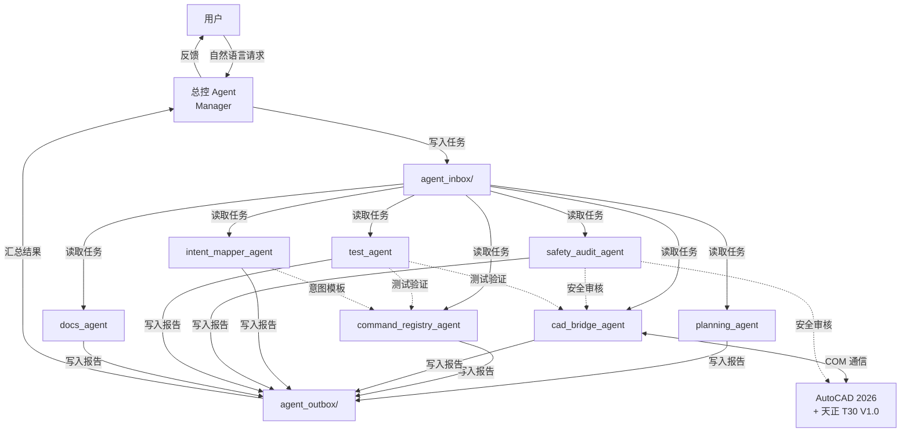
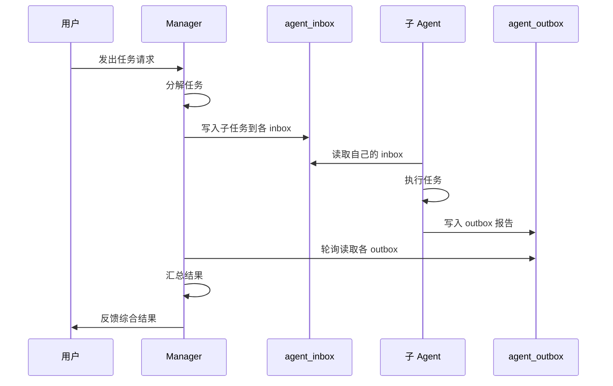

# 天正 CAD MCP 接口系统 — Multi-Agent 架构文档

## 文档信息

| 项目 | 内容 |
|------|------|
| 文档版本 | v1.0 |
| 创建日期 | 2026-07-08 |
| 创建者 | docs_agent |
| 对应阶段 | Phase M0 |
| 项目仓库 | `D:\ExampleWorkspace\天正` |

## 1. 系统概述

天正 CAD MCP 接口系统是一个基于 MCP（Model Context Protocol）的 AutoCAD + 天正给排水 T30 V1.0 智能控制系统。系统采用 Multi-Agent 协作架构，由总控 Agent 调度七个专业子 Agent，共同完成从用户意图理解、CAD 操作执行到安全审计和测试验证的完整链路。

## 2. 架构总览



## 3. 核心设计原则

### 3.1 职责分离

每个 Agent 只负责一个明确的领域，不跨域操作。例如 `docs_agent` 不能修改代码，`cad_bridge_agent` 不能修改路线图。

### 3.2 安全优先

任何涉及 CAD 的操作必须经过 `safety_audit_agent` 审计。源 DWG 只读、不写、不改、不覆盖。详见 [全局安全规则](#7-全局安全规则)。

### 3.3 文件通信

Agent 之间不直接通信，所有任务派发和结果回传通过 `agent_inbox/` 和 `agent_outbox/` 文件完成。Manager 是唯一的协调中枢。

### 3.4 阶段驱动

系统按阶段（Phase）推进，每个阶段有明确的输入、输出和完成标准。Manager 在确认全部条件满足后才能推进到下一阶段。

## 4. 模块与 Agent 对应关系

| 模块目录 | 负责 Agent | 说明 |
|---------|-----------|------|
| `cad/` | cad_bridge_agent | AutoCAD COM 通信层 |
| `tianzheng/` | cad_bridge_agent | 天正环境检测与对象读取 |
| `tianzheng_interface/` | cad_bridge_agent | 天正接口动作 Schema |
| `mcp/` | command_registry_agent | MCP 工具注册与 Pipeline |
| `execution/` | command_registry_agent | 执行计划与队列 |
| `vision/` | intent_mapper_agent | 视觉对比引擎 |
| `coordinate/` | intent_mapper_agent | 坐标映射 |
| `semantic_diff/` | intent_mapper_agent | 语义差异引擎 |
| `pipe_network/` | intent_mapper_agent | 管网拓扑图 |
| `reference/` | cad_bridge_agent | 参考 DWG 读取 |
| `roi/` | cad_bridge_agent | ROI 区域过滤 |
| `cad_compare/` | intent_mapper_agent | CAD 对比差异 |
| `tools/` | command_registry_agent | MCP 工具实现 |
| `tests/` | test_agent | 测试代码 |
| `docs/` | docs_agent | 项目文档 |
| `agent_inbox/` | Manager | 任务派发 |
| `agent_outbox/` | 各子 Agent | 结果报告 |
| `reports/` | docs_agent / Manager | 阶段报告归档 |
| `ROADMAP.md` | planning_agent | 路线图 |
| `TASK_BOARD.md` | planning_agent | 任务看板 |
| `AGENTS.md` | docs_agent | 协作规范 |

## 5. 任务生命周期



## 6. 数据流

### 6.1 从用户意图到 CAD 执行

```
用户自然语言
    → intent_mapper_agent（意图解析）
    → command_registry_agent（命令 Schema 匹配）
    → safety_audit_agent（安全审计）
    → cad_bridge_agent（COM 执行）
    → test_agent（执行验证）
```

### 6.2 从参考图纸到差异执行

```
Reference DWG + Current DWG
    → cad_bridge_agent（只读读取）
    → intent_mapper_agent（语义对比）
    → command_registry_agent（生成执行计划）
    → safety_audit_agent（安全审计）
    → cad_bridge_agent（增量执行）
    → test_agent（回归验证）
```

## 7. 全局安全规则

所有 Agent 必须遵守：

1. **禁止未经确认连接 AutoCAD**：只有 `cad_bridge_agent` 可在获得 Manager 明确授权后连接。
2. **禁止打开非任务指定的 DWG 文件**。
3. **禁止使用 SendCommand 执行破坏性操作**：包括 `ERASE`、`DELETE`、`WBLOCK`、`PURGE` 等。
4. **禁止执行天正绘图命令**（`TPIPE`、`TDRAIN`、`TSPRINKLER` 等）除非 Manager 明确授权。
5. **禁止保存/覆盖源 DWG**。
6. **禁止修改源 DWG**：源 DWG 只读、不写、不改、不覆盖。
7. **只读优先原则**：不确定安全性时选择只读，上报 Safety Audit。

## 8. 阶段状态

| 阶段 | 名称 | 状态 |
|------|------|------|
| Phase 1 | MCP Server | 已完成 |
| Phase 2 | AutoCAD Communication Layer | 已完成 |
| Phase 3 | Vision Compare Engine MVP | 已完成 |
| Phase 4 | Diff + MCP 接入 | 已完成 |
| Phase 4.5 | Coordinate Mapping Layer | 已完成 |
| Phase 4.6 | Mapped ExecutionPlan | 已完成 |
| Phase 5 | Real Current CAD Reader | 已完成 |
| Phase 5.5 | Reference DWG Reader + CAD Diff | 已完成 |
| Phase 5.5.1 | ROI Region Filter | 已完成 |
| Phase 6.0 | 天正 T30 环境接入 | 已完成 |
| Phase 6.1 | 天正对象检查器 | 已完成 |
| Phase 6.1.2 | 天正框选读取器 | 已完成 |
| Phase 6.2 | 天正语义读取器 | 已完成 |
| Phase 6.2.2 | 管径标注识别与关联 | 已完成 |
| Phase 6.2.3 | TDbPipe 深度探测 | 已完成 |
| Phase 6.2.3.1 | TDbPipe TypeInfo 属性读取 | 已完成 |
| Phase 6.3 | Semantic Diff Engine | 已完成 |
| Phase 6.4 | Pipe Network Graph Builder | 已完成 |
| **Phase M0** | **Multi-Agent 基础设施搭建** | **进行中** |
| Phase 7 | Validation / Monitor / Agent | 待开发 |

## 9. 技术栈

| 层次 | 技术 |
|------|------|
| 语言 | Python 3.13 |
| MCP 协议 | `mcp` SDK |
| CAD 通信 | `pywin32` + COM（AutoCAD 2026） |
| 天正插件 | 天正给排水 T30 V1.0 |
| 测试框架 | pytest |
| AI 模型 | OpenAI Vision (GPT-5) |
| 视觉处理 | OpenCV |
| 文档格式 | Markdown (UTF-8, LF) |
